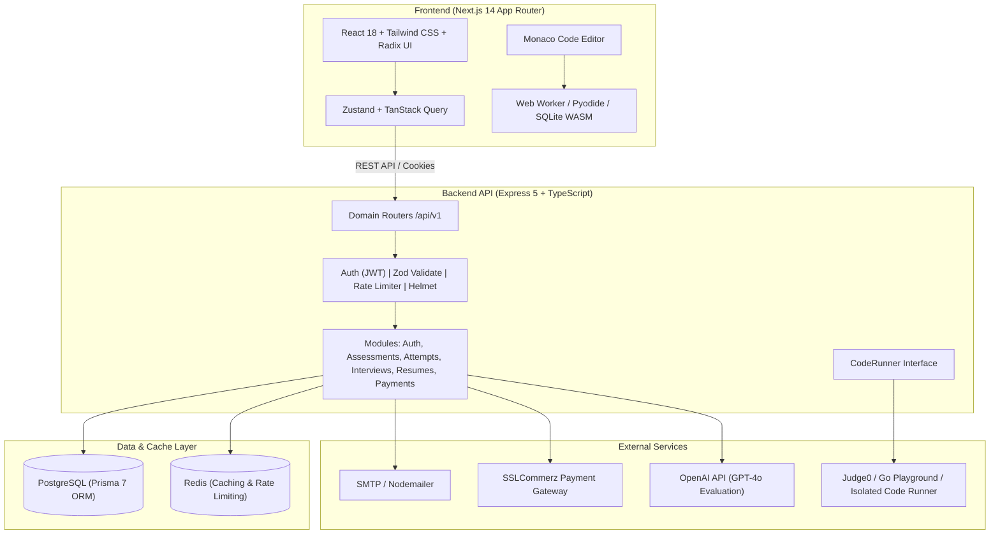
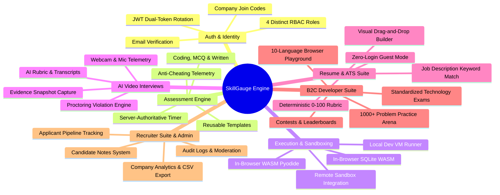
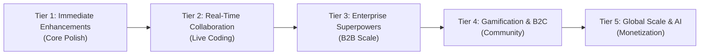
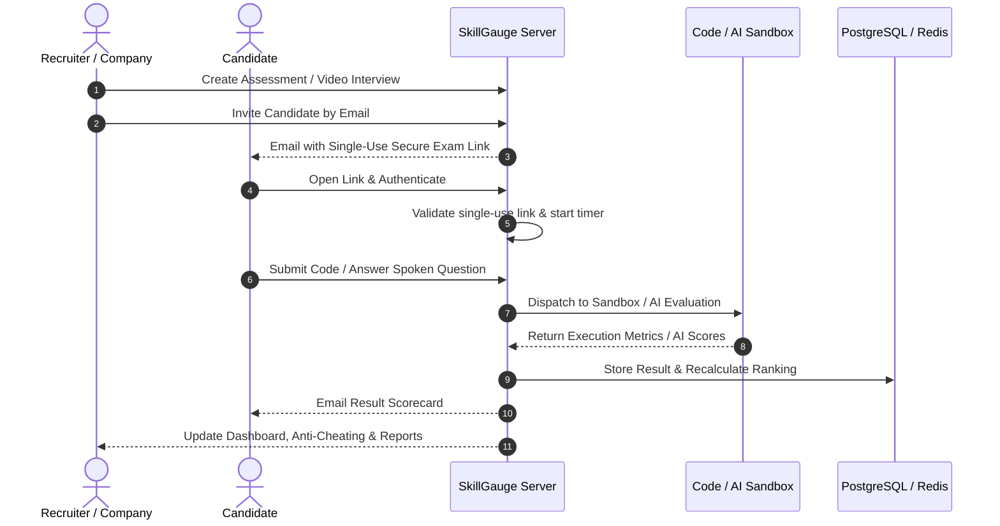

# SkillGauge — Developer Assessment & Coding Platform

[](https://nextjs.org)
[](https://expressjs.com)
[](https://www.typescriptlang.org)
[](https://www.prisma.io)
[](https://www.postgresql.org)
[](https://redis.io)
[](https://tailwindcss.com)
[](https://microsoft.github.io/monaco-editor/)

**SkillGauge** is a high-performance, full-stack B2B **and** B2C developer technical assessment and career platform:

- **B2B (Enterprise & Recruiters):** Companies, institutions, and hiring managers create **coding, MCQ, and written** assessments, run **server-timed attempts** with anti-cheating telemetry, invite candidates to **proctored AI video interviews**, evaluate code in isolated sandboxes, and export deep candidate analytics and reports.
- **B2C (Candidates & Developers):** Individual engineers register for free, practice on a curated **1,000+ problem question bank**, run snippets in an in-browser **10-language code playground**, sit for **standardized technology certification exams**, compete in **hackathons & contests**, and build ATS-optimized resumes with an **AI Resume Analyzer**.

---

## 📚 Documentation Directory

| Resource | Description | Path / URL |
| :--- | :--- | :--- |
| **Authentication & Email Flow** | Roles, join codes, verification tokens, and invitation lifecycles | [`docs/AUTH_AND_EMAIL.md`](docs/AUTH_AND_EMAIL.md) |
| **Backend Technical Guide** | Architecture, environment configuration, database setup, and deployment | [`server/README.md`](server/README.md) |
| **Complete REST API Reference** | Technical schema, database models, enums, error contracts | [`server/api.md`](server/api.md) |
| **Interactive OpenAPI / Swagger** | Interactive browser API explorer | `http://localhost:5000/api/docs` |
| **Postman Collection** | Pre-built API collection for manual testing | [`server/docs/postman-collection.json`](server/docs/postman-collection.json) |

---

## 🏛️ System Architecture



---

## 📦 Implemented Feature Inventory

SkillGauge currently includes **13 distinct functional modules** comprising **53+ production-grade features**:



### 1. Authentication, Authorization & Security (7 Features)
- **Role-Based Access Control (RBAC):** Strict permissions dividing `CANDIDATE`, `RECRUITER`, `COMPANY` (company administrator), and `ADMIN`.
- **Friendly Company Join Codes:** Recruiters onboard onto companies using human-readable codes (e.g., `TECHCOR-4F2A19`) rather than cumbersome UUIDs.
- **Dedicated Registration Portals:** Distinct, customized onboarding flows for candidates, recruiters, and companies.
- **Email Verification Tokens:** Single-use, hashed verification tokens dispatched via Nodemailer and SMTP, with auto-verification fallback for local development.
- **Dual-Token JWT Rotation:** Short-lived access tokens paired with database-persisted, hashed refresh tokens (`RefreshToken`) supporting granular revocation.
- **Self-Service Profile & Password Lifecycle:** Endpoints for changing passwords, resetting forgotten passwords, and editing personal skills, bios, and links.
- **Soft Deletion (`deletedAt`):** Safe, recoverable record lifecycle ensuring audit integrity.

### 2. Company & Recruiter Team Management (4 Features)
- **Company Profiles & Branding:** Manage organizational metadata, logos, industry categories, team sizes, and public links.
- **Team Role Hierarchy:** Fine-grained internal roles (`OWNER`, `ADMIN`, `MEMBER`) governing team recruiter seats.
- **Prepaid Credit Wallet:** Companies hold credit balances debited when assessments and interview links are published.
- **Credit Transaction Ledger:** Complete audit log (`CreditTransaction`) tracking purchases, debits, adjustments, and refunds.

### 3. Problem & Question Bank Management (6 Features)
- **Multi-Format Questions:** Full authoring support for **CODING**, **MCQ** (Multiple Choice), and **WRITTEN** (subjective / essay) problems.
- **Dual-Layer Test Cases:** Visible example test cases for candidate guidance alongside hidden validation test cases for strict grading.
- **Rich Question Metadata:** Categorization, tags, difficulty levels (`EASY`, `MEDIUM`, `HARD`), time limits, and memory limits.
- **Full-Text Problem Search:** Indexed search across titles, tags, problem statements, and technologies.
- **Usage & Performance Telemetry:** Built-in tracking for times attempted, times solved, success rates, and average scores per problem.
- **Massive Curated Problem Bank:** Seeded with **1,000+ problems** spanning JavaScript, TypeScript, Python, React, Next.js, CSS, HTML, SQL, and DevOps.

### 4. Assessment Engine & Exam Workflows (6 Features)
- **Configurable Assessment Parameters:** Tailor exam duration, passing score percentage, maximum attempt limits, and point weightings.
- **Governed Assessment State Machine:** Strict lifecycle transitions: `DRAFT → PUBLISHED → ACTIVE → CLOSED → ARCHIVED`.
- **Granular Access Control Policies:** Configure assessments as `PUBLIC`, `PRIVATE`, `INVITATION_ONLY`, or protected by `ACCESS_CODE`.
- **Anti-Bias Randomization:** Per-candidate problem shuffling and MCQ option shuffling to deter answer sharing.
- **Assessment Templates:** Save completed assessments as reusable blueprints to generate new tests with one click.
- **Cloning & Sectional Problem Grouping:** Duplicate existing assessments and organize problems into distinct test sections.

### 5. Timed Attempts & Anti-Cheating Proctoring (4 Features)
- **Server-Authoritative Clock:** The server is the single source of truth for attempt durations. Clocks cannot be manipulated client-side, and attempts auto-submit on expiration.
- **Proctoring Telemetry Tracking:** Real-time capture of client-side infractions:
  - Tab switching
  - Window blur and focus loss
  - Fullscreen exits
  - Copy and paste attempts
- **Multi-Session & Concurrent Access Prevention:** Detects and flags simultaneous sessions from different IPs or user agents (`AttemptSession`).
- **Anti-Cheating Audit Report:** Generates an infraction timeline and risk score for recruiter review.

### 6. Code Execution & Evaluation Engine (5 Features)
- **Pluggable Sandboxed Architecture:** Remote execution decoupled from the API server via the `CodeRunner` interface (supports Judge0 / remote sandbox containers).
- **Local Dev Sandbox:** Safe Node.js `vm` execution runner with CPU timeout budgets for fast local development.
- **Automated Test Evaluation:** Measures code execution time, memory usage, stdout, and error traces against all test cases.
- **Hybrid Scoring Workflow:** Instant automated grading for Coding and MCQ questions paired with recruiter review queues for Written responses.
- **Dynamic Result Recalculation:** Recomputes attempt totals and rankings automatically when written scores are updated.

### 7. Candidate Recruitment Workflows (4 Features)
- **Single-Use Secure Exam Invitations:** Token-protected email invitations bound to candidate emails that invalidate upon completion.
- **Candidate Invitation Lifecycle:** Granular status tracking: `PENDING → ACCEPTED → REJECTED → EXPIRED → COMPLETED`.
- **Recruitment Pipeline Stages:** Candidate tracking across stages: `INVITED → STARTED → COMPLETED → SHORTLISTED → INTERVIEW → HIRED → REJECTED`.
- **Candidate Collaboration Notes:** Shared or private internal recruiter notes attached to candidate profiles.

### 8. Results, Analytics & Performance Reports (5 Features)
- **Comprehensive Scorecards:** Displays percentage, points earned, pass/fail status, and percentile ranking.
- **Skill-Wise Breakdown:** Categorizes candidate performance across distinct technical competencies.
- **Recruiter Assessment Reports & CSV Export:** Aggregated performance tables with one-click CSV export for reporting.
- **Company Analytics Dashboard:** High-level metrics on pass rates, candidate throughput, and problem drop-offs (Redis cached).
- **Automated Candidate Result Emails:** Dispatches customized feedback emails immediately upon score release.

### 9. AI Video Interviews (Proctored Asynchronous Interviews) (7 Features)
- **Asynchronous Video Stream Flow:** Browser-based camera and microphone interview room requiring no third-party app installation.
- **Dynamic Question Feeds:** Draws randomized questions from a technology bank combined with company-specific questions.
- **Per-Question Timers & Progressive Hints:** Configurable per-question time limits (e.g. 5 minutes) with optional hint reveals.
- **AI-Powered Proctoring Violation Engine:** Real-time automated detection of:
  - Multiple faces detected in frame
  - Face obscured or camera blocked
  - Mobile phone or external electronic device usage
  - Second voice or background noise detected
  - Looking away from screen or tab switches
- **Visual Evidence Capture:** Captures base64 JPEG snapshots at the exact moment of violation for recruiter review.
- **Critical Violation Termination:** Configurable rules to terminate the session and assign 0 marks upon critical infractions.
- **Automated AI Grading & Recommendation:** Evaluates transcripts against model rubrics and keywords, outputting strengths, weaknesses, and hiring recommendations (`STRONG_HIRE`, `HIRE`, `MAYBE`, `NO_HIRE`).

### 10. Resume Builder & ATS Resume Analyzer (9 Features)
- **Visual Resume Builder:** Form-driven and interactive resume builder backed by a structured JSON schema.
- **ATS-Optimized Templates:** Professional, single-column and multi-column templates engineered for ATS parseability.
- **Style Customization:** Real-time font family, accent color, and section reordering controls.
- **Immutable Resume Versioning:** Save snapshots before tailoring resumes to specific roles.
- **Public Shareable Links:** Publish resumes with unique web slugs (`/resumes/shared/:slug`).
- **Print & PDF Layout:** Print stylesheets optimized for clean, multi-page PDF generation.
- **Deterministic 0–100 ATS Scoring:** Evaluates resumes across 6 key pillars: ATS readability, experience impact, skills, summary, education/projects, and grammar.
- **Job Description Match & Keyword Gap Analysis:** Compares resumes against job postings to identify missing keywords and skills.
- **Anonymous Guest Mode:** Instant builder and analyzer access for unregistered visitors via browser-persistent guest sessions.

### 11. Developer Practice Arena & Playground (B2C) (9 Features)
- **10-Language Browser Playground:** Interactive IDE supporting JavaScript, TypeScript, Python, Go, Java, SQL, HTML, CSS, Tailwind, and MUI.
- **Web Worker JavaScript/TypeScript Sandbox:** Zero-latency client-side compilation and execution in a dedicated worker.
- **In-Browser Python REPL:** Full CPython execution inside WebAssembly via Pyodide.
- **In-Browser SQLite WASM:** Client-side relational database playground pre-loaded with sample schemas and table viewers.
- **Live HTML/CSS Preview:** Sandboxed iframe preview with bidirectional console message forwarding.
- **Remote Sandbox Proxy:** Server proxy executing Go (via official Go playground) and Java (via Judge0) with stdout/stderr streaming.
- **Practice Arena:** LeetCode-style problem-solving portal with Monaco editor, difficulty filters, and automated test runners.
- **Standardized Technology Exams:** Free certification exams (React, JavaScript, Python, SQL, DevOps) with verifiable digital scorecards.
- **Coding Competitions:** Timed hackathons and contests with public live leaderboards.

### 12. Payments, Billing & Credit Wallet (4 Features)
- **Credit Package Store:** Transparent tier-based credit packages for recruiters.
- **SSLCommerz Payment Integration:** Secure checkout flow handling session initiation, success, failure, and cancellations.
- **Idempotent IPN Webhook:** Instant Payment Notification webhook handler preventing duplicate credit allocation.
- **Payment Transaction Logs:** Detailed financial receipts and transaction history records.

### 13. Platform Administration & Security Governance (4 Features)
- **Central Admin Control Center:** System dashboard displaying total platform revenue, active assessments, users, and companies.
- **User Account Management:** Administrative tools to suspend, activate, delete, or reassign user roles.
- **System Audit Logs (`AuditLog`):** Immutable logging recording actor IDs, actions, entity diffs, timestamps, IPs, and user agents.
- **Notification Hub:** In-app notification center for invitations, results, payments, and system alerts.

---

## 🔍 Code Review & Engineering Highlights

```
================================================================================
                    SKILLGAUGE CODE HEALTH AUDIT
================================================================================
Architecture           [████████████████████] 100% - Clean Domain Layering
Type Safety            [████████████████████] 100% - Strict TypeScript + Zod
Security Model         [████████████████░░░░]  85% - JWT Rotation + RBAC + Sandbox
Database Design        [██████████████████░░]  90% - 34 Prisma Models + Indexes
Observability          [████████████████░░░░]  80% - Correlation IDs + Logs
================================================================================
```

### Key Engineering Strengths
1. **Zero Server Code Execution:** Arbitrary candidate code is never executed directly inside the Node.js API process. It is dispatched to isolated workers or containers.
2. **Clock Drift Immunity:** The server calculates attempt durations against database timestamps, completely neutralizing client clock manipulation.
3. **Graceful Degradation:** Both the AI Video Interview and the Resume ATS Analyzer include deterministic fallback scoring engines when external LLMs are unavailable.
4. **Structured Request Correlation:** Every incoming HTTP request is tagged with an `X-Request-Id` header for end-to-end trace correlation in logs.

### Key Architectural Recommendations
* **Rate-Limit Guest Identity Creation:** In `server/src/modules/resumes/guestIdentity.ts`, limit on-demand `prisma.user.create()` and bcrypt calls for anonymous visitors to protect against database bloat and CPU exhaustion.
* **Guest-to-User Account Merge:** Automatically associate guest resumes and analyses with a user's account when they register or log in.
* **Reactivate Uptime Health Check:** Enable the `/health` endpoint in `server/src/app.ts` to support container and orchestration health probes.

---

## 🚀 Feature Roadmap — What We Can Add Next

A prioritized roadmap of **25 high-impact features** across 5 strategic tiers to scale SkillGauge to enterprise standards:



### 🎯 Tier 1: Immediate Enhancements (Core Polish)
| Feature | Target Audience | Description | Impact |
| :--- | :--- | :--- | :--- |
| **1. Guest Resume Account Claiming** | Candidates | Automatically transfer all guest resumes and ATS reports to a registered account upon sign-up. | High |
| **2. Server-Side PDF Microservice** | Candidates / Recruiters | Replace client-side browser print with a headless Chromium (Puppeteer) service for pixel-perfect PDF downloads. | High |
| **3. Code Plagiarism & MOSS Engine** | Recruiters | Implement AST token similarity detection to identify code shared between candidates or copied from the web. | High |
| **4. AI Practice Mock Interviews** | Candidates | Allow individual developers to take practice video interviews with AI feedback before official company screenings. | High |
| **5. Health & Prometheus Metrics** | DevOps | Re-enable `/health` with ping checks for PostgreSQL and Redis, and expose `/metrics` for Prometheus. | Medium |

### ⚡ Tier 2: Real-Time Collaboration & Live Interviews
| Feature | Target Audience | Description | Impact |
| :--- | :--- | :--- | :--- |
| **6. Live 1-on-1 Pair Programming** | Recruiters & Candidates | Real-time collaborative coding room with shared Monaco editor (CRDT/Yjs), WebRTC audio/video call, and shared execution. | High |
| **7. Candidate Screen Share Proctoring** | Recruiters | Stream candidate screen shares during coding assessments to detect unauthorized tabs or secondary IDEs. | High |
| **8. WebSocket / SSE Notification Stream** | All Users | Push live notifications, real-time proctoring alerts, and contest leaderboard updates without page refreshes. | Medium |
| **9. Interactive STDIN Terminal** | Candidates | Support real-time interactive terminal input/output for coding problems instead of static batch strings. | Medium |
| **10. System Design Whiteboard** | Recruiters & Candidates | An integrated collaborative canvas (Excalidraw-style) for architecture and system design interviews. | High |

### 🏢 Tier 3: Enterprise & Recruiter Superpowers
| Feature | Target Audience | Description | Impact |
| :--- | :--- | :--- | :--- |
| **11. ATS Integrations (Greenhouse, Lever)** | Enterprise | Two-way API sync to automatically trigger SkillGauge assessments and sync scores back into candidate ATS pipelines. | High |
| **12. AI Question & Test Case Generator** | Recruiters | Upload a job description or prompt and let an LLM generate custom coding problems, MCQs, and edge-case test suites. | High |
| **13. Custom White-Labeling & Branding** | Enterprise | Custom subdomains (`assess.company.com`), branded email templates, company logos, and color palettes. | High |
| **14. Bulk Candidate CSV Dispatch** | Recruiters | Upload candidate CSV rosters with automated batch exam invitation dispatching. | Medium |
| **15. Talent Pool Semantic Search** | Recruiters | Search past candidate submissions and resumes using natural language (e.g. *"Show candidates with >80% on Node.js and SQL"*). | High |

### 🎮 Tier 4: Candidate Experience & Gamification
| Feature | Target Audience | Description | Impact |
| :--- | :--- | :--- | :--- |
| **16. Daily Coding Challenges & Streaks** | Candidates | Daily problem drops with calendar streak tracking, solution discussions, and achievement badges. | High |
| **17. Verified Public Developer Profile** | Candidates | Shareable portfolio pages (`skillgauge.com/@username`) showcasing verified test badges, competition rankings, and public resumes. | High |
| **18. AI Code Complexity Assistant** | Candidates | Instant post-submission breakdown of Big-O time and space complexity with actionable refactoring advice. | Medium |
| **19. Community Solutions & Editorial** | Candidates | LeetCode-style community solution discussions, upvoting, and official editorial walk-throughs. | Medium |
| **20. Curated Learning Roadmaps** | Candidates | Structured learning paths (Frontend, Backend, DevOps, DSA) that recommend practice problems as candidates progress. | Medium |

### 🌐 Tier 5: Global Expansion & Monetization
| Feature | Target Audience | Description | Impact |
| :--- | :--- | :--- | :--- |
| **21. Global Payment Gateways (Stripe, PayPal)** | Enterprise & Candidates | Multi-currency card processing to support international recruiters alongside SSLCommerz. | High |
| **22. SaaS Recurring Subscriptions** | Enterprise | Monthly and annual subscription tiers (Starter, Growth, Enterprise) with seat licenses in addition to credit packages. | High |
| **23. Conversational AI Voice Interviewer** | Enterprise & Candidates | Upgrade video interview AI to an interactive conversational voice agent (OpenAI Realtime API) that asks follow-up questions dynamically. | High |
| **24. Multilingual Platform (i18n)** | All Users | Full localization support for candidate assessment interfaces and problem statements. | Medium |
| **25. Git Repository Project Assessments** | Enterprise & Candidates | Candidates clone a GitHub repository, implement features, and submit via git push, evaluated by automated CI/CD test suites. | High |

---

## 🔄 End-to-End Workflow



---

## 📁 Repository Structure

```
SkillGauge/
├── frontend/                       # Next.js 14 App Router Frontend
│   ├── src/
│   │   ├── app/                    # Pages & Route Handlers
│   │   │   ├── admin/              # Admin dashboard & governance pages
│   │   │   ├── candidate/          # Candidate portal (dashboard, attempts, results)
│   │   │   ├── recruiter/          # Recruiter portal (assessments, interviews, reports)
│   │   │   ├── interview/          # Proctored AI video interview room
│   │   │   ├── playground/         # Multi-language browser code playground
│   │   │   ├── practice/           # 1,000+ problem practice arena
│   │   │   ├── exams/              # Standardized technology certification exams
│   │   │   ├── competitions/       # Coding hackathons & live leaderboards
│   │   │   ├── resume-builder/     # Visual resume authoring tool
│   │   │   ├── resume-analyzer/    # ATS resume analyzer & job matching
│   │   │   └── resume-templates/   # Template showcase gallery
│   │   ├── components/             # Reusable UI primitives & feature components
│   │   ├── hooks/                  # Custom React hooks (useResumes, useAuth, etc.)
│   │   ├── lib/                    # API clients, playground runners, constants
│   │   └── store/                  # Client state stores (Zustand)
│   └── package.json
│
├── server/                         # Express 5 + TypeScript REST API
│   ├── src/
│   │   ├── app.ts                  # App configuration & middleware pipeline
│   │   ├── server.ts               # HTTP server entry point
│   │   ├── config/                 # Environment variables & runtime settings
│   │   ├── middlewares/            # Auth, validation, rate limiting, error handler
│   │   ├── lib/                    # Prisma client, Redis, codeRunner, audit logger
│   │   ├── modules/                # Domain-driven backend modules
│   │   │   ├── admin/              # User/company administration
│   │   │   ├── assessments/        # Assessment creation, lifecycle, templates
│   │   │   ├── attempts/           # Timed attempt management & clock authority
│   │   │   ├── auth/               # Registration, login, token refresh, verification
│   │   │   ├── companies/          # Organization & team seat management
│   │   │   ├── evaluations/        # Automated code & manual written scoring
│   │   │   ├── interviews/         # Video interview management & AI proctoring
│   │   │   ├── invitations/        # Single-use email invitations
│   │   │   ├── payments/           # SSLCommerz payment integration
│   │   │   ├── problems/           # Question bank CRUD & search
│   │   │   ├── reports/            # Assessment reports & CSV export
│   │   │   ├── results/            # Scorecards, percentiles, skill breakdowns
│   │   │   ├── resumes/            # Resume builder, ATS analyzer & scoring
│   │   │   ├── submissions/        # Code submissions & sandbox dispatch
│   │   │   └── users/              # User profiles & settings
│   │   └── routes/                 # Consolidated API routing table
│   ├── prisma/                     # Database schema, migrations & seed scripts
│   └── package.json
│
├── docs/                           # Architectural specifications & guides
│   └── AUTH_AND_EMAIL.md           # Authentication & invitation deep-dive
├── package.json                    # Root monorepo workspace scripts
└── README.md                       # ← You are here
```

---

## 🚀 Quick Start

### Option A — Full Monorepo Development (Recommended)

Run both the frontend and backend with a single command from the root directory:

```bash
# 1. Install dependencies across root, frontend and server
npm install

# 2. Setup environment files
cp server/.env.example server/.env
cp frontend/.env.example frontend/.env.local

# 3. Setup database (PostgreSQL required)
cd server
npm run db:migrate
npm run db:seed
cd ..

# 4. Start both client and server concurrently
npm run dev
```

* Frontend: `http://localhost:3000`
* Backend API: `http://localhost:5000`
* Swagger Docs: `http://localhost:5000/api/docs`

---

### Option B — Docker Compose (PostgreSQL + Redis + API)

```bash
cd server
cp .env.example .env
docker compose up -d
```

---

### 🔑 Demo Seed Credentials

| Role | Email | Password | Access Scope |
| :--- | :--- | :--- | :--- |
| **Admin** | `admin@skillgauge.local` | `Admin123!` | Full platform administration & governance |
| **Recruiter** | `recruiter@techcorp.dev` | `Recruit123!` | Assessment, interview & candidate management |
| **Candidate** | `candidate@skillgauge.local` | `Candid8te!` | Assessment attempts, exams, practice & resumes |

---

## 🌐 API Overview

- **Base URL:** `http://localhost:5000`
- **Prefix:** `/api/v1`
- **Auth Header:** `Authorization: Bearer <accessToken>`
- **Standard JSON Response Envelope:**

```json
{
  "success": true,
  "message": "Operation successful",
  "data": {}
}
```

### Core API Route Groups

| Domain | Route Prefix | Access Control | Highlights |
| :--- | :--- | :--- | :--- |
| **Auth** | `/api/v1/auth` | Public / Bearer | Register, login, refresh-token, verify-email, reset-password |
| **Users** | `/api/v1/users` | Bearer | Profile update, password change, user details |
| **Companies** | `/api/v1/companies` | Recruiter / Admin | Company profile, recruiter management, join codes |
| **Problems** | `/api/v1/problems` | Recruiter / Admin | CRUD for Coding, MCQ, Written questions, search |
| **Assessments**| `/api/v1/assessments` | Recruiter / Admin | Lifecycle, question mapping, duplication, settings |
| **Invitations**| `/api/v1/invitations` | Recruiter / Candidate| Send email invites, accept/reject exam invites |
| **Attempts** | `/api/v1/attempts` | Candidate / Recruiter| Start attempt, server timer, save answers, submit |
| **Submissions**| `/api/v1/submissions` | Candidate / Recruiter| Code submission, execution trigger, test case logs |
| **Evaluations**| `/api/v1/evaluations` | Recruiter / Admin | Manual written grading, automated code evaluation |
| **Results** | `/api/v1/results` | Candidate / Recruiter| Scorecards, rankings, skill performance breakdown |
| **Interviews** | `/api/v1/interviews` | Recruiter / Admin | Create video interviews, question banks, AI review reports |
| **Interview Sessions** | `/api/v1/interview-sessions` | Public / Token | Candidate video interview room, telemetry, snapshots |
| **Resumes** | `/api/v1/resumes` | Public / Guest / User| Visual resume CRUD, ATS analyzer, job match, versions |
| **Payments** | `/api/v1/payments` | Recruiter / Admin | Packages, initiate SSLCommerz checkout, IPN webhook |
| **Admin** | `/api/v1/admin` | Admin Only | System users, companies, revenue, audit logs |

---

## 🧪 Sample Payloads for API Testing

### 1. Create a CODING Problem
```http
POST /api/v1/problems
Content-Type: application/json
Authorization: Bearer <recruiterAccessToken>
```
```json
{
  "title": "Two Sum",
  "description": "Given an array of integers nums and an integer target, return indices of the two numbers such that they add up to target.",
  "type": "CODING",
  "difficulty": "EASY",
  "category": "algorithms",
  "points": 20,
  "timeLimit": 5,
  "memoryLimit": 256,
  "allowedLanguages": ["javascript", "python", "typescript"],
  "examples": [{ "input": "[2,7,11,15], 9", "output": "[0,1]" }],
  "testCases": [
    { "input": "[2,7,11,15]\n9", "expectedOutput": "[0,1]", "isHidden": false, "order": 0 },
    { "input": "[3,2,4]\n6", "expectedOutput": "[1,2]", "isHidden": true, "order": 1 }
  ]
}
```

### 2. Create an Assessment
```http
POST /api/v1/assessments
Content-Type: application/json
Authorization: Bearer <recruiterAccessToken>
```
```json
{
  "title": "Full Stack Senior Screening",
  "description": "Screening assessment covering React, Node.js, and Algorithms.",
  "durationMinutes": 60,
  "passingScore": 70,
  "maxAttempts": 1,
  "shuffleProblems": true,
  "antiCheatingEnabled": true,
  "showCandidateRanking": true,
  "accessLevel": "INVITATION_ONLY"
}
```

### 3. Analyze a Resume against a Job Description
```http
POST /api/v1/resumes/analyses
Content-Type: application/json
x-guest-id: guest-browser-uuid-1234
```
```json
{
  "source": "BUILDER",
  "resumeId": "<resume-uuid>",
  "jobDescription": "We are seeking a Full Stack Developer with React, TypeScript, Node.js, and PostgreSQL experience to build scalable web applications."
}
```

---

## 📄 License

This project is licensed under the ISC License. All rights reserved.
