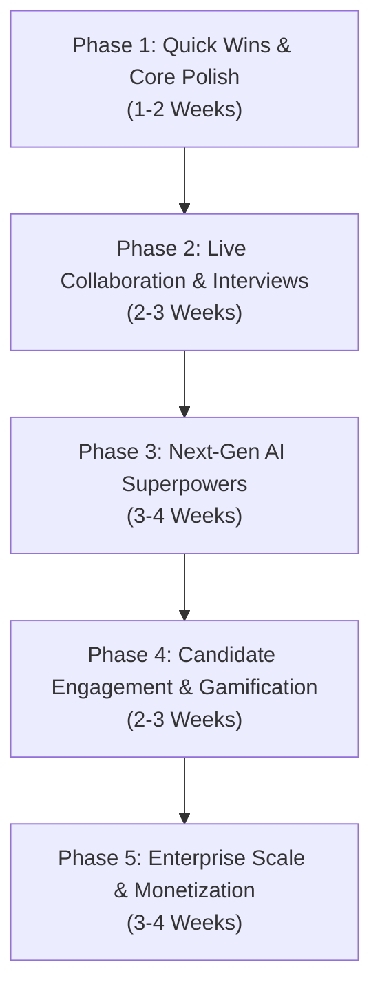
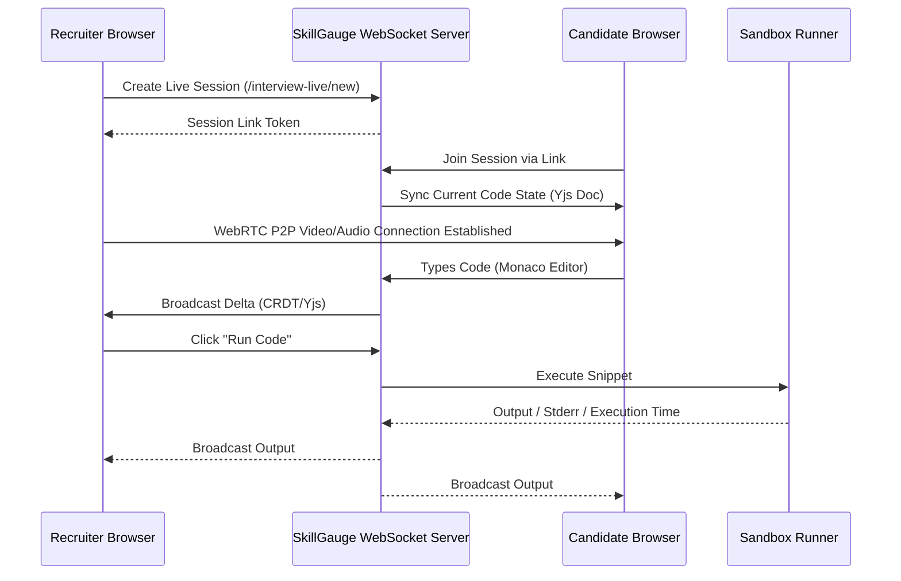
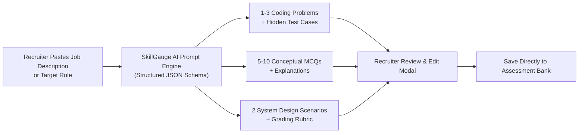
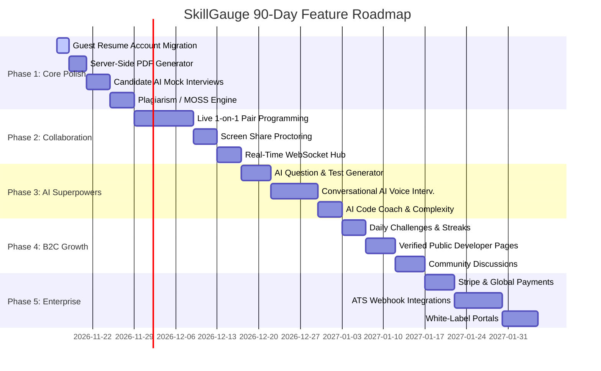

# SkillGauge — Feature Expansion Roadmap & Implementation Guide

This document is the definitive product and engineering roadmap for **SkillGauge**. It details all the features that can be implemented in the platform, complete with technical specifications, architecture blueprints, database schema additions, and step-by-step implementation guides.

---

## 🧭 Roadmap Overview & Strategic Horizon



---

## 📋 Comprehensive Feature Catalog

### Summary Table

| Phase | Feature Name | Target Audience | Complexity | Est. Effort |
| :--- | :--- | :--- | :--- | :--- |
| **Phase 1** | **1.1 Guest Resume Account Claiming** | Candidates | Low | 1–2 days |
| | **1.2 Server-Side High-Fidelity PDF Generator** | Candidates / Recruiters | Medium | 2–3 days |
| | **1.3 Plagiarism & Code Similarity Engine** | Recruiters | Medium | 3–5 days |
| | **1.4 Candidate AI Practice Mock Interviews** | Candidates | Medium | 3–4 days |
| | **1.5 Production Health Checks & Prometheus Metrics** | DevOps / System | Low | 1 day |
| **Phase 2** | **2.1 Live 1-on-1 Pair Programming Room** | Recruiters & Candidates | High | 1–2 weeks |
| | **2.2 Dual-Stream Screen Share & Video Proctoring** | Recruiters | Medium | 4–6 days |
| | **2.3 Real-Time WebSocket / SSE Event Hub** | All Users | Medium | 3–5 days |
| | **2.4 Interactive STDIN Terminal for Code Challenges** | Candidates | High | 1 week |
| | **2.5 Collaborative System Design Whiteboard** | Recruiters & Candidates | Medium | 4–6 days |
| **Phase 3** | **3.1 AI Question & Test Case Generator** | Recruiters | Medium | 3–5 days |
| | **3.2 Conversational AI Voice Interviewer** | All Users | High | 1–2 weeks |
| | **3.3 AI Code Coach & Big-O Complexity Profiler** | Candidates | Medium | 3–4 days |
| | **3.4 Semantic Talent Pool Search (Vector Search)** | Recruiters | Medium | 4–6 days |
| | **3.5 Resume-to-Assessment Recommender** | Candidates | Low | 2 days |
| **Phase 4** | **4.1 Daily Coding Challenges & Streak Tracking** | Candidates | Medium | 3–4 days |
| | **4.2 Verified Public Profiles & Digital Badges** | Candidates | Medium | 3–5 days |
| | **4.3 Community Solution Discussions & Editorials** | Candidates | Medium | 4–5 days |
| | **4.4 Curated Career Roadmaps & Skill Trees** | Candidates | Low | 2–3 days |
| | **4.5 Team Hackathons & Group Competitions** | Communities & Clubs | High | 1–2 weeks |
| **Phase 5** | **5.1 Two-Way ATS Integrations (Greenhouse, Lever)** | Enterprise | High | 1–2 weeks |
| | **5.2 Global Multi-Currency Payments (Stripe/PayPal)**| Enterprise & Candidates | Medium | 4–5 days |
| | **5.3 Enterprise SaaS Subscriptions & Seat Licenses**| Enterprise | Medium | 4–6 days |
| | **5.4 Custom White-Labeling & Branded Subdomains** | Enterprise | Medium | 1 week |
| | **5.5 Full-Stack GitHub Repository Project Tests** | Enterprise & Candidates | High | 2 weeks |

---

## 🛠️ Detailed Feature Specifications & Implementation Guides

---

### Phase 1: Quick Wins & Core Polish

#### 1.1 Guest Resume Account Claiming & Auto-Migration
* **What it does:** Automatically claims and migrates all resumes, job descriptions, and ATS analysis reports created by an anonymous visitor (`x-guest-id`) when they register or log in.
* **Why build it:** Closes a major user retention leak where visitors build a resume as a guest, create an account, but cannot see their work.
* **Technical Architecture:**
  * In `server/src/modules/auth/auth.controller.ts`, read the `x-guest-id` header on `register` and `login`.
  * If a guest user exists for that guest ID, execute an atomic transaction reassigning all child records:
    ```typescript
    await prisma.$transaction([
      prisma.resume.updateMany({
        where: { ownerId: guestUser.id },
        data: { ownerId: authenticatedUser.id },
      }),
      prisma.jobDescription.updateMany({
        where: { ownerId: guestUser.id },
        data: { ownerId: authenticatedUser.id },
      }),
      prisma.resumeAnalysis.updateMany({
        where: { ownerId: guestUser.id },
        data: { ownerId: authenticatedUser.id },
      }),
      prisma.user.delete({ where: { id: guestUser.id } }),
    ]);
    ```
* **Frontend Hook:** Pass the stored `guestId` from `localStorage` in auth headers during registration.

---

#### 1.2 Server-Side High-Fidelity PDF Generation Service
* **What it does:** Generates pixel-perfect, ATS-verified PDF downloads for resumes on the server using headless Chromium, eliminating inconsistencies in client browser `window.print()`.
* **Technical Architecture:**
  * Add endpoint `POST /api/v1/resumes/:id/export-pdf`.
  * Use **Puppeteer** or **Playwright** inside a worker process or serverless function:
    ```typescript
    import puppeteer from "puppeteer";

    export async function renderResumePdf(resumeHtml: string): Promise<Buffer> {
      const browser = await puppeteer.launch({ headless: true, args: ["--no-sandbox"] });
      const page = await browser.newPage();
      await page.setContent(resumeHtml, { waitUntil: "networkidle0" });
      const pdf = await page.pdf({
        format: "A4",
        printBackground: true,
        margin: { top: "10mm", bottom: "10mm", left: "10mm", right: "10mm" },
      });
      await browser.close();
      return Buffer.from(pdf);
    }
    ```
  * Return `Content-Type: application/pdf` with `Content-Disposition: attachment; filename="resume.pdf"`.

---

#### 1.3 Plagiarism & Code Similarity Detection (MOSS Engine)
* **What it does:** Automatically flags candidates who submit identical or paraphrased code from other applicants or public online repositories.
* **Algorithm & Architecture:**
  * **AST Tokenization:** Parse candidate code into abstract syntax tree tokens using `@babel/parser` (JS/TS), `tree-sitter`, or Python AST parser.
  * **Normalization:** Discard comments, whitespace, and rename all user identifiers to generic symbols (`$v1`, `$fn1`).
  * **Winnowing / N-Gram Hashing:** Generate rolling hashes (k-grams) of the token stream.
  * **Jaccard Similarity Index:** Calculate percentage overlap between submissions:
    $$\text{Similarity}(A, B) = \frac{|H(A) \cap H(B)|}{|H(A) \cup H(B)|}$$
  * Store infractions in a new model `SubmissionSimilarity` and alert recruiters on the assessment review dashboard.

---

#### 1.4 Candidate AI Practice Mock Interviews (B2C)
* **What it does:** Allows individual developers to take on-demand, practice technical interviews with automated AI feedback, question hints, and performance scoring.
* **Implementation Blueprint:**
  * Extend `server/src/modules/interviews` with a new endpoint: `POST /api/v1/interviews/practice/start`.
  * Candidate selects technology (e.g. React, Node.js, Python, System Design) and difficulty.
  * The session generates 5 spoken questions from the question bank.
  * Evaluates responses via the existing AI rubric engine, producing:
    * Speaking pace and clarity feedback
    * Keyword and technical depth score
    * Detailed model answer comparisons
    * Private scorecard saved to candidate's profile

---

#### 1.5 Production Health Checks & Prometheus Metrics API
* **What it does:** Restores and upgrades `/health` and introduces `/metrics` for system reliability.
* **Implementation:**
  * Add deep health checks in `server/src/app.ts`:
    * PostgreSQL `SELECT 1` ping and connection pool latency
    * Redis `PING` check
    * Remote code runner reachability
  * Add `prom-client` middleware exposing standard Prometheus metrics (HTTP request durations, memory usage, active DB connections) at `GET /metrics` protected by an internal secret.

---

### Phase 2: Live Collaboration & Real-Time Interviewing

#### 2.1 Live 1-on-1 Pair Programming Interview Room ("SkillGauge Live")
* **What it does:** A real-time collaborative coding environment for live technical interview rounds between an interviewer and candidate.



* **Technology Stack:**
  * **Collaborative Editor:** Monaco Editor bound to **Yjs** with `y-webrtc` or `y-websocket`.
  * **Live Video / Audio:** **LiveKit** or **PeerJS** for zero-latency browser audio/video mesh.
  * **Shared Terminal:** Both candidate and recruiter can trigger execution and view real-time standard output.
  * **Interviewer Notes & Scorecard:** Private live scoring rubric for the recruiter during the call.

---

#### 2.2 Dual-Stream Screen Share & Video Proctoring
* **What it does:** Captures the candidate's active display screen alongside their webcam stream during timed exams.
* **Capabilities:**
  * Prompts candidate for `navigator.mediaDevices.getDisplayMedia({ video: true })`.
  * Detects when screen share is stopped or secondary monitors are connected.
  * Periodically samples screen frames to flag unauthorized ChatGPT/IDE windows.

---

#### 2.3 Real-Time WebSocket / SSE Event Hub
* **What it does:** Eliminates polling across the app by pushing instant updates to connected browser clients.
* **Use Cases:**
  * Live notifications for assessment invitation acceptances
  * Real-time proctoring alerts dispatched to recruiter dashboard during active exams
  * Live competition leaderboard ranking updates
  * Notification toast popups when written answers are scored

---

#### 2.4 Interactive STDIN Terminal for Code Challenges
* **What it does:** Upgrades the code runner from static batch inputs to an interactive terminal emulator (using `xterm.js`).
* **Why build it:** Essential for algorithms that require interactive inputs (e.g. games, graph traversals, REPL-style coding challenges).
* **Architecture:** Docker container with a WebSockets bridge (`ws-pty`) streaming raw stdin and terminal control sequences.

---

#### 2.5 Collaborative System Design Whiteboard
* **What it does:** An infinite collaborative canvas integrated into the live interview room.
* **Implementation:** Embed an open-source **Excalidraw** or **tldraw** canvas synchronized via WebSockets, allowing candidates to diagram microservice architectures, database schemas, and data pipelines in real time.

---

### Phase 3: Next-Gen AI Superpowers

#### 3.1 AI Question & Test Case Generator for Recruiters
* **What it does:** Automatically synthesizes custom technical assessments from a simple recruiter prompt or pasted Job Description.



* **Backend Endpoint:** `POST /api/v1/assessments/ai-generate`
* **Features:**
  * Generates problem description, constraints, and starter boilerplate code in JavaScript, Python, Java, and Go.
  * Synthesizes 5 public test cases and 10 hidden edge-case test cases (handling empty inputs, large numbers, duplicates, and timeouts).
  * Automatically sets difficulty rating and tags.

---

#### 3.2 Conversational AI Voice Interviewer (OpenAI Realtime API)
* **What it does:** Replaces static text cards with an interactive AI voice interviewer that verbally asks questions, listens to the candidate's answers, and asks intelligent follow-up questions.
* **Architecture:**
  * Uses the **OpenAI Realtime API** over WebSockets / WebRTC.
  * System prompt instructs the persona to act as a Senior Technical Lead.
  * Dynamic follow-ups: If candidate mentions *"We used Redis for caching"*, the AI automatically asks: *"How did you handle cache invalidation and thundering herd problems?"*

---

#### 3.3 AI Code Coach & Big-O Complexity Profiler
* **What it does:** Provides instant, structured feedback on candidate code in the Practice Arena:
  * Calculates theoretical **Time Complexity** ($O(N)$, $O(N \log N)$) and **Space Complexity**.
  * Highlights code smell and edge cases that could cause memory overflow.
  * Displays a side-by-side refactored version with idiomatic best practices.

---

#### 3.4 Semantic Talent Pool Search (Vector Search)
* **What it does:** Enables recruiters to search across all past candidate resumes, interview transcripts, and code submissions using natural language.
* **Technical Architecture:**
  * Store candidate embeddings in PostgreSQL using the **pgvector** extension.
  * Generate text embeddings via `text-embedding-3-small`.
  * Recruiter query: *"Find backend engineers who understand event-driven Kafka architectures and scored >80% on SQL."*
  * Performs cosine similarity search across candidates:
    $$\cos(\theta) = \frac{\mathbf{A} \cdot \mathbf{B}}{\|\mathbf{A}\| \|\mathbf{B}\|}$$

---

### Phase 4: Candidate Engagement & Gamification (B2C Community)

#### 4.1 Daily Coding Challenges & Streak Tracking
* **What it does:** Drops a fresh coding problem every 24 hours with streak tracking, progress heatmaps, and reminder notifications.
* **Data Model:**
  ```prisma
  model UserDailyStreak {
    id            String    @id @default(uuid())
    userId        String    @unique
    user          User      @relation(fields: [userId], references: [id])
    currentStreak Int       @default(0)
    longestStreak Int       @default(0)
    lastSolvedAt  DateTime?
    activityMap   Json?     // { "2026-11-15": 2, "2026-11-16": 1 }
  }
  ```

---

#### 4.2 Verified Public Developer Profiles & Digital Badges
* **What it does:** Creates public developer portfolio URLs (e.g. `skillgauge.dev/@alex`) displaying verified exam certificates, contest rankings, skill radar charts, and public ATS resumes.
* **Viral Acquisition:** Developers share their verifiable SkillGauge certificate links directly on their LinkedIn profiles and resumes.

---

#### 4.3 Community Solution Discussions & Editorials
* **What it does:** After successfully solving a practice problem, candidates unlock an interactive discussion board.
* **Features:**
  * Multi-language official editorials explaining brute force, optimal, and alternative solutions.
  * Candidate-submitted solutions with markdown rendering, syntax highlighting, and upvoting.

---

#### 4.4 Curated Career Roadmaps & Interactive Skill Trees
* **What it does:** Visual learning paths (Frontend, Backend, DevOps, Data Structures) that track progress as candidates complete exercises, guiding them towards job readiness.

---

### Phase 5: Enterprise Scale, Integrations & Monetization

#### 5.1 Two-Way ATS Integrations (Greenhouse, Lever, Workday)
* **What it does:** Integrates SkillGauge directly into corporate recruitment pipelines.
* **Workflow:**
  1. Recruiter moves applicant to "Technical Assessment" stage in Greenhouse.
  2. Greenhouse webhook triggers SkillGauge `POST /api/v1/integrations/greenhouse/candidate-stage-change`.
  3. SkillGauge emails the test invitation link to the candidate.
  4. Upon candidate submission, SkillGauge pushes the scorecard, anti-cheating report, and PDF link back into Greenhouse candidate notes.

---

#### 5.2 Global Multi-Currency Payments (Stripe & PayPal)
* **What it does:** Expands monetization beyond Bangladesh (SSLCommerz) to international recruiters and candidates.
* **Supported Methods:**
  * **Stripe Checkout & Billing:** Credit card processing in USD, EUR, GBP, AUD, etc.
  * **PayPal Express Checkout:** Seamless one-click global payments.
  * **Customer Portal:** Automated invoicing, tax receipts, and payment method management.

---

#### 5.3 Enterprise SaaS Subscriptions & Seat Licensing
* **What it does:** Supplements credit package purchases with recurring monthly/annual subscriptions.
* **Tiers:**
  * **Free / Developer (B2C):** Practice bank, playground, community solutions, 1 resume.
  * **Starter ($99/mo):** 3 recruiter seats, 50 monthly assessment invitations, basic proctoring.
  * **Growth ($299/mo):** 10 seats, unlimited assessments, AI video interviews, CSV export.
  * **Enterprise (Custom):** Dedicated sandbox runner, custom SLA, white-label subdomain, ATS integrations.

---

#### 5.4 Custom White-Labeling & Branded Subdomains
* **What it does:** Allows enterprise clients to deliver technical assessments under their own brand:
  * Custom subdomain: `assess.uber.com` or `techcorp.skillgauge.com`
  * Organization logo and brand color palettes across all test screens
  * Custom email domain dispatch (`invites@careers.company.com`)

---

#### 5.5 Full-Stack GitHub Repository Project-Based Assessments
* **What it does:** Tests real-world engineering skills by evaluating complete multi-file repositories rather than single algorithmic functions.
* **Workflow:**
  1. Candidate clicks "Start Project Exam" → SkillGauge clones a private template repository to candidate's GitHub account.
  2. Candidate clones locally or opens in web IDE, implements the requested endpoints/features.
  3. Candidate runs `git push origin main`.
  4. SkillGauge GitHub App receives push webhook, spawns an isolated Docker container, executes automated test suites (e.g. `npm test`), and records the score.

---

## 📈 Suggested 90-Day Implementation Plan



---

## 🏁 Summary & Getting Started

To begin implementing any feature:
1. Select a feature from **Phase 1** (recommended: **Guest Resume Account Claiming** or **Candidate AI Mock Interviews**).
2. Create a feature branch: `git checkout -b feat/<feature-name>`.
3. Follow the architecture blueprint and schema additions specified in this document.
4. Update unit and integration tests under `server/src` and `frontend/src`.
